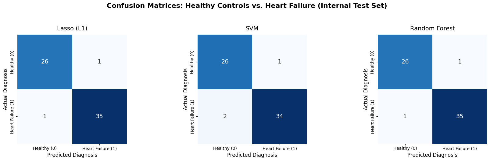
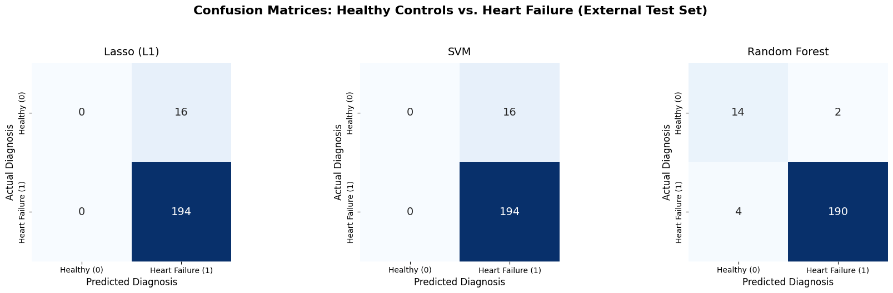
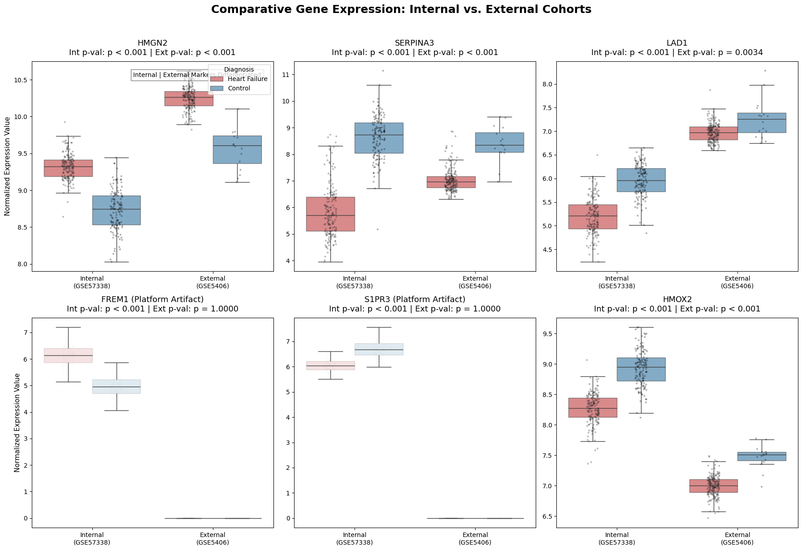

# Explainable ML for Heart Failure Gene Signatures

BSc Data Science dissertation (University of Sheffield, 2026), supervised by Dr Zeyneb Kurt. A related paper was accepted at UKCI 2026.

The project classifies **failing vs non-failing human left-ventricle tissue** from microarray gene expression with Lasso, SVM and Random Forest models. **SHAP** explains each model, and a consensus across the three gives a gene signature. The signature is checked on an independent cohort from a different array platform and biologically through pathway enrichment.

| Cohort | Role | Platform | Samples | Non-failing | Ischemic CM | Dilated CM |
|---|---|---|---|---|---|---|
| [GSE57338](https://www.ncbi.nlm.nih.gov/geo/query/acc.cgi?acc=GSE57338) | training + internal test | Affymetrix HuGene 1.1 ST | 313 | 136 | 95 | 82 |
| [GSE5406](https://www.ncbi.nlm.nih.gov/geo/query/acc.cgi?acc=GSE5406) | external validation | Affymetrix HG-U133A | 210 | 16 | 108 | 86 |

Ischemic and idiopathic dilated cardiomyopathy are pooled into one **heart failure** class (label 1), and non-failing donor hearts are label 0.

**Research questions:** (RQ1) How accurately can ML separate failing from non-failing hearts? (RQ2) Which genes drive the predictions, according to SHAP? (RQ3) Do the models and signature carry over to an independent cohort?

---

## Pipeline

```
GEO raw data ──► R/01_*  (RMA normalisation, probe → gene symbol)
             ──► notebooks/heart_failure_ml_shap_pipeline.ipynb
                   labels + QC → top-5,000 variance genes → align external cohort
                   → Lasso / SVM / RF (60/20/20 split, 5-fold grid search)      [RQ1]
                   → external validation on GSE5406                              [RQ3]
                   → SHAP per model → min-max normalised consensus → top-25
                   → cross-cohort 6-gene panel → expression boxplots             [RQ2]
             ──► R/07_pathway_enrichment.R  (Reactome + KEGG ORA)
```

| Path | What it does |
|---|---|
| `R/00_install_packages.R` | Installs the CRAN and Bioconductor packages |
| `python/00_extract_cel_files.py` | Unpacks `GSE57338_RAW.tar` into `.CEL` files |
| `R/00_download_metadata_GSE57338.R` | Sample labels for GSE57338 (a copy is already in `data/`) |
| `R/01_rma_normalise_GSE57338.R` | `oligo` RMA (background correction, quantile normalisation, log2), probes → symbols, duplicates averaged |
| `R/01_download_GSE5406.R` | GEO series matrix via `GEOquery`, `hgu133a.db` probe → symbol, duplicates averaged |
| **`notebooks/heart_failure_ml_shap_pipeline.ipynb`** | **Main analysis** (outputs from the dissertation run are kept) |
| `R/07_pathway_enrichment.R`, `07b_print_top_pathways.R` | Over-representation analysis with `clusterProfiler` / `ReactomePA` |
| `python/early_versions/` | Earlier standalone scripts for labelling, QC, variance and ANOVA selection, and alignment, later folded into the notebook |
| `R/probe_to_symbol_map.R` | Probe-ID → symbol dictionary (used by an early script) |

## Results

### RQ1: internal test set (GSE57338, 63 held-out samples)

| Model | Best parameters | 5-fold CV acc. | Test accuracy | AUC | MCC |
|---|---|---|---|---|---|
| Lasso (L1 logistic) | C = 0.1 | 98.9% | 96.8% | 0.977 | 0.935 |
| SVM | linear, C = 0.1 | 97.3% | 95.2% | 0.975 | 0.904 |
| Random Forest | 200 trees | 97.8% | 96.8% | **0.985** | 0.935 |



### RQ3: external validation (GSE5406, 210 samples, 16 controls)

| Model | Accuracy | AUC | MCC | Control recall |
|---|---|---|---|---|
| Lasso | 92.4% | 0.953 | 0.000 | 0 / 16 |
| SVM | 92.4% | 0.962 | 0.000 | 0 / 16 |
| Random Forest | **97.1%** | 0.960 | **0.810** | 14 / 16 |

Lasso and SVM label every external sample as heart failure: their 92.4% equals the share of failing hearts, and MCC is 0. The AUCs are still high, so the ranking carries over but the decision threshold doesn't. Only Random Forest transfers as a classifier.



### RQ2: SHAP consensus signature

Mean |SHAP| per gene is min-max normalised per model and summed over the three models (maximum 3). The cross-cohort panel adds the internal and external consensus scores (maximum 6):

| Gene | Internal | External | Cross-cohort |
|---|---|---|---|
| S1PR3 | 2.00 | 2.75 | 4.75 |
| HMGN2 | 2.63 | 1.08 | 3.71 |
| SERPINA3 | 2.31 | 1.03 | 3.34 |
| FREM1 | 1.34 | 1.24 | 2.58 |
| LAD1 | 1.18 | 0.78 | 1.96 |
| HMOX2 | 1.12 | 0.81 | 1.93 |



SHAP beeswarm plots for each model are in [`results/figures/`](results/figures/).

### Pathway enrichment

`R/07_pathway_enrichment.R` tests a 25-gene list (HMGN2, SERPINA3, LAD1, FREM1, S1PR3, HMOX2, SH2D1B, S100A8, PGLYRP1, CXCL8, PROK2, VCAN, THBS1, LCN2, CASTOR2, NUB1, ANXA3, TNFAIP6, FCGR3B, ADGRE2, VNN1, PADI4, HCK, FCN1, GPR84):

| Database | Pathway | Genes | Adjusted p |
|---|---|---|---|
| Reactome | Neutrophil degranulation | 10 / 22 | 6.6 × 10⁻⁷ |
| Reactome | Antimicrobial peptides | 3 / 22 | 0.044 |
| KEGG | IL-17 signalling pathway | 3 / 15 | 0.019 |
| KEGG | Phagocytosis | 4 / 15 | 0.019 |

Full tables are in [`results/pathways/`](results/pathways/).

---

## Getting started

### 1. Environment

```bash
git clone https://github.com/dunciu/heart-failure-gene-signature.git
cd heart-failure-gene-signature
python -m venv .venv && source .venv/bin/activate     # Windows: .venv\Scripts\activate
pip install -r requirements.txt
Rscript R/00_install_packages.R                        # R ≥ 4.3
```

### 2. Data

Expression data is public on GEO but too large for git (the GSE57338 raw archive alone is 1.4 GB):

- **GSE57338:** download `GSE57338_RAW.tar` (Supplementary file on the [GEO page](https://www.ncbi.nlm.nih.gov/geo/query/acc.cgi?acc=GSE57338)) into `data/`.
- **GSE5406:** downloaded automatically by `R/01_download_GSE5406.R`.

Sample metadata for both cohorts is already in `data/`.

### 3. Run (from the repository root)

```bash
python python/00_extract_cel_files.py
Rscript R/01_rma_normalise_GSE57338.R        # → data/GSE57338_Cleaned_Normalized.csv
Rscript R/01_download_GSE5406.R              # → data/GSE5406_Expression_Matrix.csv
jupyter notebook notebooks/heart_failure_ml_shap_pipeline.ipynb    # set DATA_DIR in the first cell
Rscript R/07_pathway_enrichment.R
```

The notebook also runs on Google Colab: set `DATA_DIR = "/content/drive/MyDrive/Dissertation"` in the first cell.

## Notes and caveats

- **GSE5406 normalisation step missing:** the notebook reads `GSE5406_Cleaned_Normalized.csv` (13,631 genes), but `R/01_download_GSE5406.R` produces `GSE5406_Expression_Matrix.csv` and the script that normalised it wasn't saved. Until it's added, rename or normalise that file yourself.
- **Zero-padding of missing genes:** 1,590 of the 5,000 training genes don't exist on the GSE5406 array and are filled with 0. After the training-set scaler, those columns become extreme negative values. That explains why **S1PR3 and FREM1**, both absent from GSE5406 (the boxplots flag them as platform artefacts), rank highest in the *external* SHAP consensus, and why Lasso/SVM collapse to predicting every sample as heart failure. Restricting both cohorts to their 3,410 shared genes would give a cleaner external test and signature.
- **The 25-gene enrichment list:** its first six genes and CASTOR2 come from the SHAP consensus. The other 18 (S100A8, CXCL8, LCN2, …) aren't in either top-25 table the notebook produces. Document where that list came from before citing the enrichment as validation of the SHAP signature.
- **Imbalanced external cohort:** only 16 controls out of 210, so MCC, balanced accuracy and per-class recall matter more than accuracy.
- **Variance filter on all samples:** the top-5,000 variance filter uses all 313 GSE57338 samples before the train/test split. It's unsupervised, so labels don't leak, but test-set expression does shape which genes are kept.

## Acknowledgements

Supervised by Dr Zeyneb Kurt (University of Sheffield). Data from the NCBI Gene Expression Omnibus: GSE57338 (Liu et al., 2015) and GSE5406 (Hannenhalli et al., 2006).

## Author

**Duncan Alexander**, BSc Data Science, University of Sheffield · [github.com/dunciu](https://github.com/dunciu)
